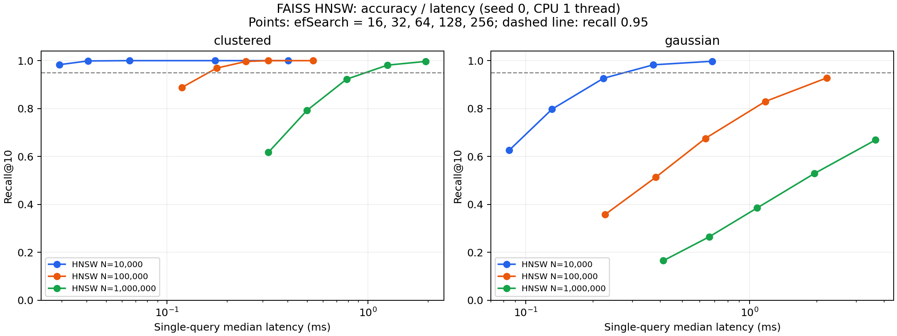
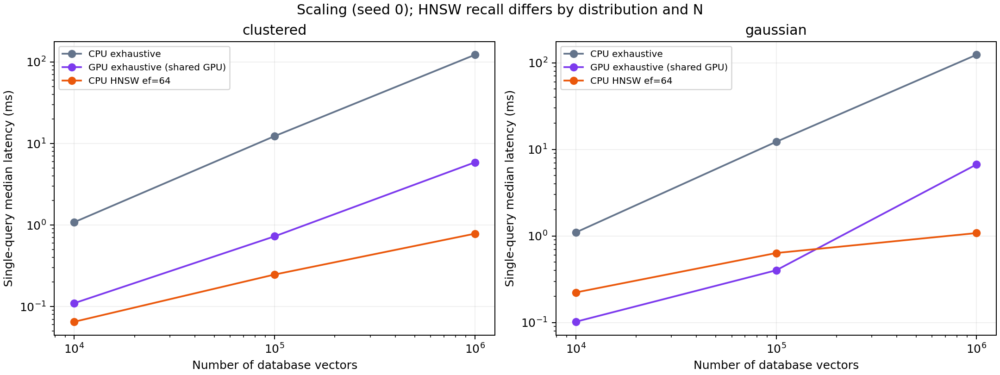

# kubera GPU2：FAISS HNSW ベクトル検索実証

ユーザーの依頼に基づき、人工128次元ベクトルで実験を実施した。HNSWによる検索の動作、高速化、精度とのトレードオフを確認した。ロボットや模倣学習への有効性を測定した実験ではない。

結果の一次記録は[全測定値](../../artifacts/faiss_hnsw_demo/metrics.csv)、[実行ログ](../../artifacts/faiss_hnsw_demo/run.log)、[環境情報](../../artifacts/faiss_hnsw_demo/environment.json)。下記の数値・結論はこれらに基づく。

## 実行環境と測定条件

- サーバー：kubera、Xeon Silver 4210R。専用Dockerコンテナ、CPU上限8コア、RAM上限12GiB。
- GPU：物理GPU2、Quadro RTX 6000 23,040MiB、UUID `GPU-afb08f75-2bc5-9c02-469e-c29b6940c8f2`。このGPUだけを公開し、コンテナ内番号は0。
- HNSWとCPU全探索はCPU実行。GPU2では `GpuIndexFlatL2` による全探索を測定した。HNSW自体をGPUで実行したという意味ではない。
- 開始時にGPU2は19,479MiB使用中、空き3,212MiB。他ジョブを停止・変更していない。GPU測定は共有負荷の影響を含み、専有状態での性能上限を示さない。
- Python 3.11.9、NumPy 1.26.4、FAISS 1.9.0。PyPI配布の `faiss-gpu-cu12==1.9.0.post1` を使用。
- FAISSのコンパイル設定は `OPTIMIZE GENERIC GPU`。CPUのAVX2/AVX512向け最適化ビルドとの比較はしていない。今回の倍率を最適化済みCPU実装への一般的な優位性として扱わない。
- 登録：1万・10万・100万件、128次元float32。L2距離、top-10。
- クラスタ：100中心（各成分は標準偏差3の正規分布）＋標準偏差1の正規ノイズ。比較用：各成分が標準正規分布に従う独立ベクトル。
- クエリ：登録データと独立に生成した1,000件。自己検索は動作確認にのみ使用。
- 10万件はseed 0/1/2、1万・100万件はseed 0。大規模条件のseed間の再現性は未検証。
- HNSW：`M=32`、`efConstruction=200`、`efSearch=16/32/64/128/256`。構築8スレッド、検索1スレッド。並列構築は非決定性を含む。
- 単発時間：ウォームアップ後、1,000クエリを3巡。各巡の順序をshuffleし、計3,000回の中央値とp95を算出。
- バッチQPS：1,000クエリをまとめた検索を5回、時間の中央値で算出。単発時間の逆数ではない。
- GPU：float32、NumPyホスト入出力、転送込み、明示的に同期。テンポラリメモリは128MiBに制限。
- Recall@10：CPU全探索の上位10 ID集合との共通ID数/10をクエリで平均。GPUの浮動小数点演算差による順位差も反映する。
- 検索時間にデータ生成・インデックス構築・ディスクI/Oは含めない。

実行開始：`2026-11-06T17:13:35+09:00`、終了：`2026-11-06T17:51:31+09:00`（JST）。環境JSONの元記録はUTC。70条件の測定を完了。

## クラスタデータ：95%以上のRecallで高速化できたか

各規模のseed 0について、測定したHNSW設定のうちRecall@10が95%以上で単発中央値が最も短いものを掲載する。設定は測定後に選んだもので、別の検証データで最適化したものではない。

| 登録件数 | efSearch | Recall@10 | CPU全探索 ms | HNSW中央値 ms | HNSW p95 ms | CPU全探索/HNSW |
| --- | --- | --- | --- | --- | --- | --- |
| 10,000 | 16 | 98.32% | 1.086 | 0.029 | 0.048 | 37.2倍 |
| 100,000 | 32 | 96.88% | 12.329 | 0.177 | 0.218 | 69.7倍 |
| 1,000,000 | 128 | 98.13% | 122.527 | 1.254 | 1.418 | 97.7倍 |

## 10万件：seedを変えた3回の結果

以下は3つのseedの最小–最大。固定した設定で集計し、独立な再構築・データ生成で傾向を確認した。

| 分布 | efSearch | Recall@10 % | 単発中央値 ms | 構築秒（8スレッド） |
| --- | --- | --- | --- | --- |
| clustered | 32 | 96.770–97.300 | 0.170–0.177 | 4.814–5.278 |
| clustered | 64 | 99.620–99.650 | 0.227–0.247 | 4.814–5.278 |
| gaussian | 128 | 82.490–83.040 | 1.177–1.302 | 30.601–32.632 |
| gaussian | 256 | 92.350–92.800 | 2.213–2.464 | 30.601–32.632 |

10万件のクラスタでは95%以上を維持してCPU全探索より速い設定が得られた。一方、独立正規乱数データは今回の探索範囲では95%未達。データ分布に依存し、任意のベクトルで同じ精度・倍率になるとは言えない。

100万件の乱数データは、efSearch=256でもRecall@10が66.90%、単発中央値3.655msだった。今回の設定では95%の目標を満たさなかった。

## GPU2による全探索との比較

seed 0の値。GPUは共有状態、転送込み。CPU HNSWは固定efSearch=64であり、規模・分布によってRecallが異なる。速度だけの比較で同じ品質とみなさない。

| 分布 | 件数 | GPU全探索中央値 ms | GPU Recall@10 | GPUバッチQPS | HNSWバッチQPS | HNSW Recall@10 |
| --- | --- | --- | --- | --- | --- | --- |
| clustered | 10,000 | 0.110 | 100.00% | 1,368,798 | 15,863 | 100.00% |
| clustered | 100,000 | 0.728 | 100.00% | 92,250 | 4,303 | 99.65% |
| clustered | 1,000,000 | 5.880 | 100.00% | 19,695 | 1,321 | 92.25% |
| gaussian | 10,000 | 0.102 | 100.00% | 1,179,411 | 4,789 | 92.65% |
| gaussian | 100,000 | 0.402 | 100.00% | 134,147 | 1,558 | 67.57% |
| gaussian | 1,000,000 | 6.691 | 100.00% | 16,915 | 947 | 38.50% |

GPU全探索は1,000件をまとめた処理で高いスループットを示した。単発問い合わせとバッチ処理では最適な選択が異なるため、研究への導入時は実際の問い合わせ頻度・バッチサイズで判断する。

## 構築時間・保存容量

seed 0。HNSWは直列化サイズ、Flatはベクトル本体のサイズで、一時バッファやGPUコンテキストを含まない。

| 件数 | HNSW構築秒 clustered | HNSW構築秒 gaussian | HNSW MiB | Flatベクトル MiB |
| --- | --- | --- | --- | --- |
| 10,000 | 0.360 | 0.869 | 7.47 | 4.88 |
| 100,000 | 5.278 | 30.601 | 74.79 | 48.83 |
| 1,000,000 | 200.049 | 543.984 | 747.80 | 488.28 |

CSVの最大RSSはプロセス開始からの累積ピーク（全条件で最大3805.4MiB）であり、各インデックス単独のメモリ使用量ではない。GPUメモリを含まない。[GPU監視ログ](../../artifacts/faiss_hnsw_demo/gpu_monitor.csv)も共有GPU全体の値であり、本実験単独の使用量ではない。

## 動作検証とグラフ

1万件の両分布で、既知ベクトル10件の自己検索（ID一致・距離0）と保存・再読込後のID・距離の完全一致をassertで検証した。実行ログに両条件のPASSと全条件終了の `COMPLETE` がある。全70条件のCSV列・件数も回収後に検証した。

## 成果物と再実行

- ローカル実装：`/home/wada-lab/Univ/research26_workspace/faiss_hnsw_demo/`。
- サーバー：`/home/wadaharuto/research26_workspace/faiss_hnsw_demo/`。
- [コード](../../artifacts/faiss_hnsw_demo/benchmark.py)、[Dockerfile](../../artifacts/faiss_hnsw_demo/Dockerfile)、[再実行手順](../../artifacts/faiss_hnsw_demo/README.md)、[集計コード](../../artifacts/faiss_hnsw_demo/summarize.py)、[集計JSON](../../artifacts/faiss_hnsw_demo/summary.json)。
- インデックス保存検証用の `.faiss` ファイルは実装ディレクトリの `results/` とサーバーに保持し、Wikiには重複保存しない。
- ホスト名のDNS解決が不安定だったため、過去の実験記録にあるIP `10.0.16.19` に `HostKeyAlias=kubera.bigdata-lab` を指定し、既知のホスト鍵を検証して接続した。

公式仕様：[Faiss indexes](https://github.com/facebookresearch/faiss/wiki/Faiss-indexes)、[Faiss on the GPU](https://github.com/facebookresearch/faiss/wiki/Faiss-on-the-GPU)。HNSWの背景：[原論文](../../raw/papers/malkov_2018_hnsw.pdf)。今後ロボットに接続する場合は、実際の埋め込みの分布と検索件数で同じ比較を行い、検索結果が方策の性能に与える影響を別途検証する必要がある。
