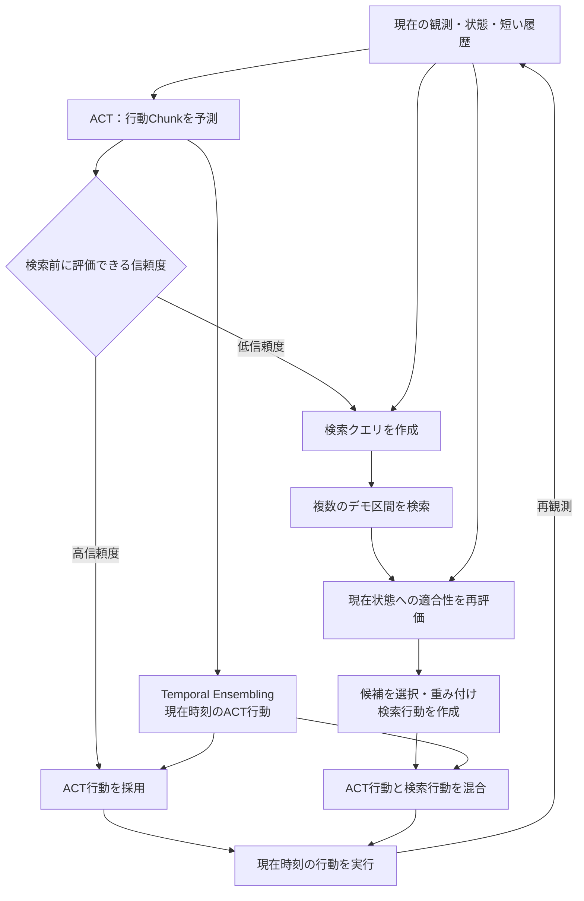
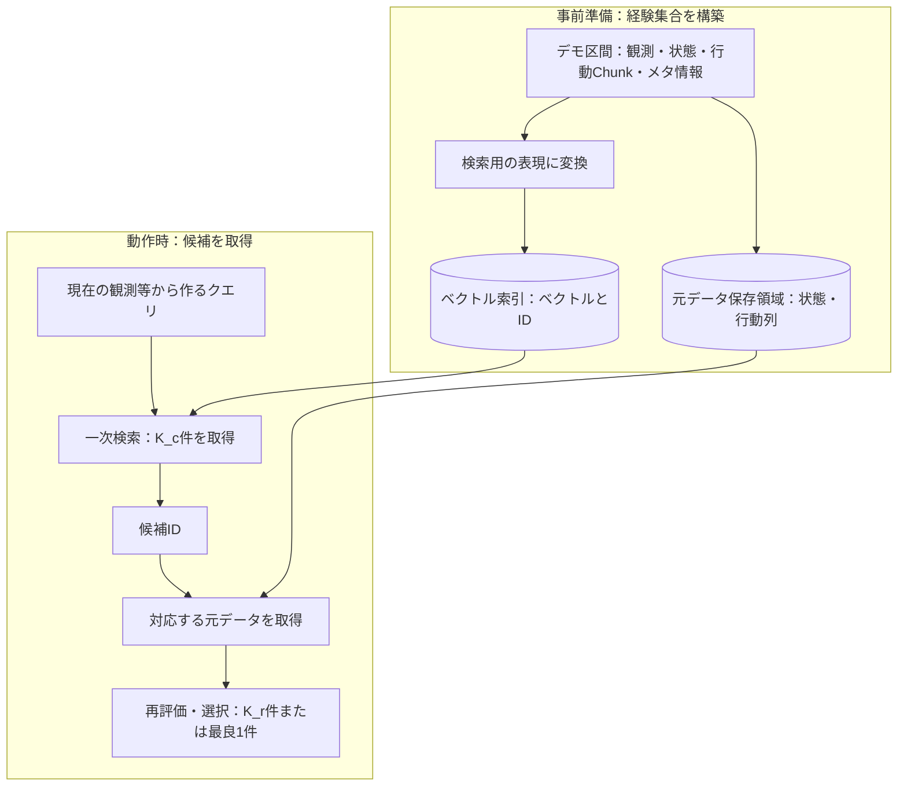
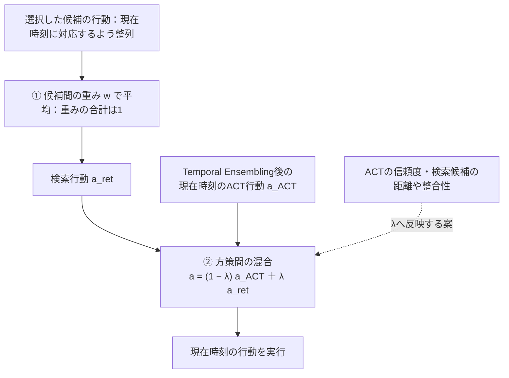

# 信頼度に応じた動作時検索とACTの混合による模倣学習：研究計画

## 1. 文書の位置づけ

2026-11-04のユーザーとの議論をまとめた研究計画。ユーザーの明示的な依頼により `lab/research_policy/` に保存する。過去の[1013計画](1013計画.md)および[10月16日の研究概要](../presentation/research_overview_20261016.md)からの方針変更を記録する。既存の記録は当時の履歴として残す。

- **ユーザーが示した方針**：学習前のデータ拡張を中心とした研究から、動作時の検索でACTを補完する研究へ変更する。ACTの信頼度が低いときに複数候補を検索し、候補の再評価を経てACT出力と検索行動を重み付き平均する。信頼度に応じた探索量の変更も検討する。
- **ユーザーが示した実験の進め方**：まず動作の検索が可能であることから、段階的に示す。
- **本記事で具体化した実装・評価案**：以下で「案」「候補」と記載する詳細は未採用・未検証。検索表現、信頼度、混合則、評価件数などの確定仕様ではない。
- **実証状況**：本記事は計画であり、新方式の実装完了・成功率改善・高速化を報告するものではない。

研究方針の出典は上記の会話であり、論文による実証結果と区別する。技術的な既知事項には、保存済み一次資料へのリンクを付す。

## 2. 目的と方針変更の理由

従来は、対象タスクの少数デモをクエリとして類似デモ区間を検索し、ACTの学習データに追加する方針だった。[旧方針](1013計画.md)

新方針では、ACTの学習後、ロボットが動作を決定する際に検索を使う。ユーザーの問題意識は「学習前の一括検索だけでは、高速角度判定カーネルの高速性を活かす動機が弱い」というもの。そこで、制御の時間予算内で検索・候補の再評価・行動の混合を行う構成を検討する。

**研究上の仮説**：ACTが不確かな場面で適切な経験を取得し、その行動を利用することで、ACT単独より良い動作を決定できる。検索を高速化すれば、同じ時間予算内で探索や再評価へ計算を配分し、成功率と応答時間の両立を改善できる可能性がある。いずれも未検証であり、低信頼度なら検索が必ず有効という前提は置かない。

## 3. 対象と研究範囲

従来の実験環境方針を出発点として、MuJoCo上のACT・双腕マニピュレーションを想定する。Transfer Cubeを最初の候補とし、成立後にBimanual Insertion等へ広げる実施案とする。最終的な採用タスク・デモ数は未決定。ACT原論文では両タスクのシミュレーション評価を行っている。[出典：ACT §V](../../raw/papers/zhao_2023_act.pdf)

- 中心は模倣学習と推論時検索であり、報酬によるオンラインRL更新は本計画の中核に含めない。
- 初期段階は同じロボット、同じ行動定義、単一タスクの経験集合から開始する案。複数タスク・大規模化は基本動作を確認してから扱う。
- ACTの再学習を伴わない検索補完を初期構成とする案。検索表現や判定器の学習とは区別する。
- 「グラフデータベース」は、本計画では主にHNSW等のグラフ型ベクトル索引と、元のデモ区間を取得する保存領域を指す。知識グラフの推論は要求しない。
- 実機、力覚拡張、回復専用データ、動的な経験追加は当面の必須要件としない。過去の[広い研究計画案](../meeting/research_plan_retrieval_augmented_ACT.md)の全項目を引き継ぐものではない。

## 4. システムの全体像

矢印は処理・データの流れを示す。高信頼度ではACT行動を採用し、低信頼度では検索経路を使う。図中の信頼度は検索前に評価できるスコアを想定する。検索結果を使う信頼スコア（§6.2）は、検索後に評価する別案である。

これはユーザーの方針を整理した概念構成。最初から全要素を実装せず、後述の実験段階で順に追加する。

高信頼度時にも軽い検索を行い、必要に応じて深い探索へ進む構成は別の比較案とする。信頼度自体を検索結果から計算する場合、検索前の判定と検索後の判定を分け、循環した定義にしない。

## 5. 経験集合と検索対象

### 5.1 保存する情報の案

| 情報 | 用途 |
| --- | --- |
| 画像、関節位置、gripper状態等 | クエリ・候補の状態表現 |
| 状態に対応する正解行動と未来の行動Chunk | 検索後の動作利用 |
| episode ID、時刻、区間長、valid mask | 元データの復元と区間の整列 |
| タスクID、成功・失敗等のメタ情報（利用可能なら） | 条件の統制と結果分析 |
| 検索用ベクトル | ベクトル索引への登録 |

検索用ベクトルと元の動作データは区別する。近傍IDから、対応する状態・行動列を取得できるようにする。初期は成功デモのみの索引を候補とし、失敗経験の登録は独立した実験とする。

索引から得たIDを使い、元データ保存領域から対応する状態・行動列を取得する。一次検索は厳密検索から確認し、その後HNSW、HNSW＋KS₂へ移す（§7.1）。

### 5.2 検索ベクトルの候補

- 画像の特徴ベクトル。
- 関節位置・gripper状態などの状態ベクトル。
- 画像と状態を統合したベクトル。
- 短い観測履歴を表現したベクトル。

いずれも未決定。初期の動作確認ではシミュレーション状態を利用する構成も考えられるが、物体の真の位置など、通常のACT観測に含まれない情報を使う場合は「特権的な状態情報を使う検証」と明記する。最終的に利用可能な観測で成立するかを別に検証する。

実行時には未来の正解行動は利用できない。ACTの予測Chunkをクエリに含める設計は可能性として残すが、現在状態だけの検索と分けて検証する。

距離関数、正規化、画像と関節状態の重み、次元数は未決定。KS₂はHNSW内のユークリッド距離に基づくroutingにも接続されるため、「角度判定カーネルを使うからクエリは必ずコサイン距離」とは決めない。[出典：KS §6.2](../../raw/papers/lu_2025_ks_angle_testing.pdf)

## 6. ACTの信頼スコア

標準ACTでは、学習時にCVAE encoderを使い、実行時は通常z=0で行動Chunkを生成する。標準出力が成功確率を表すわけではない。[出典：ACT §IV-B–C、Algorithms 1–2](../../raw/papers/zhao_2023_act.pdf)

以下の3案はユーザーが提示した候補であり、採用方式は未決定。

### 6.1 Temporal Ensembling前のChunk間の不一致

異なる時刻に生成したChunkのうち、**同じ実行時刻に対応する予測**を比較する。ACTのTemporal Ensemblingも、同一実行時刻を対象とした予測を統合する。[出典：ACT §IV-A、Fig.5、Algorithm 2](../../raw/papers/zhao_2023_act.pdf)

実装候補として、長さHのChunkに対して

$$
u_t=\frac{1}{H-1}\sum_{j=0}^{H-2}\|\hat a_{t+j\mid t}-\hat a_{t+j\mid t-1}\|_W^2
$$

を用いる。ここで $\hat a_{\tau\mid t}$ は時刻tに予測した実行時刻τの行動、Wは行動成分のスケールを調整する重み。H>1とし、利用可能な重なりだけを比較する。式は本計画の候補であり、ACT原論文の信頼度定義ではない。

不一致が大きいことを低信頼度の手掛かりにする。ただし、環境変化への正しい修正も不一致を生み得る。逆に、一貫した誤動作や停止は見逃し得るという設計上の懸念がある。スコアを直ちに成功確率とは呼ばず、失敗との対応を評価する。

### 6.2 状態検索と取得経験との比較

検索距離、近傍行動とACT行動の差、近傍行動同士の不一致などを使う候補。現在状態に適切な経験があるかと、ACTがその経験に整合するかを分ける。

検索前の起動判定には使えないため、軽い検索後の追加判定、または常時検索する比較方式として扱う。近似探索の取りこぼしと経験不足を混同しないよう、厳密検索との照合を行う。

### 6.3 失敗を学ぶ別ネットワーク

ユーザー案の「失敗時のAction Chunkを学ぶネットワーク」を、状態・履歴・ACTの予測Chunkから将来の失敗リスクを予測する判定器として具体化する案。失敗動作を生成するネットワークとは区別する。

失敗の種類・予測時間幅・ラベル付けは未決定。失敗したepisodeの全区間を一律に失敗扱いしないことを検討する。失敗データ収集と判定器学習が必要なので、初期の検索成立の検証とは分離する。

## 7. 候補取得と再評価

### 7.1 一次検索

現在のクエリから候補をK_c件取得する。最初は厳密検索で確認し、その後HNSW、HNSW＋KS₂へ移す。K_c、返却候補数、efSearchは別のパラメータとして管理する。

HNSWの検索時efは保持する候補集合の大きさを調整するパラメータであり、訪問ノード数や時間の厳密な上限ではない。[出典：HNSW Algorithms 2・5](../../raw/papers/malkov_2018_hnsw.pdf)

### 7.2 再評価の案

検索距離だけでなく、以下の情報を使って候補の適合性を再評価する。

- 現在の関節姿勢・gripper状態との整合。
- 短い観測履歴、タスク段階との対応。
- 直前に実行した動作からの連続性。
- 候補の行動が、現在の行動定義・単位・座標系に適合するか。

初期は軽量な規則や距離の組合せを候補とし、学習型の再評価器は必須にしない。再評価式・重みは未決定。ACTへの一致だけで評価すると補完すべき候補を排除する可能性があるため、ACTとの不一致を即座に不適合としない。

再評価した後、K_c件からK_r件を使う、または最良1件を使う方式を比較する。複数取得することと全件を平均することは区別する。重複した隣接フレームばかり取得していないかをepisode ID・時刻で確認する。

## 8. ACTと検索結果の混合

### 8.1 二段階の重み

ユーザーの最終的な目標は、信頼度に応じた重み付き平均。候補間の平均と方策間の混合を分ける。

$$
a_t^{ret}=\sum_{i=1}^{K_r}w_{t,i}a_{t,i}^{demo},\qquad w_{t,i}\ge0,\quad\sum_iw_{t,i}=1
$$

$$
a_t=(1-\lambda_t)a_t^{ACT}+\lambda_t a_t^{ret},\qquad0\le\lambda_t\le1
$$

wは候補間の重み、λは検索側を使う比率。候補1件、複数候補の類似度重み、再評価後の重みを比較する。λの固定値と信頼度による変更を比較する。具体的な関数形は未決定。

ACT側の信頼度だけでなく、検索候補の距離・整合性もλへ反映する案とする。両方が不確かな場合の処理は未決定であり、低信頼度なら必ず検索側へ全面的に移すとはしない。候補棄却・ACT継続・停止等のルールは評価前に定め、失敗や停止も結果へ含める。

①のwは検索候補間の配分、②のλは検索側を使う比率を決める。点線は信頼度等を混合率へ反映する設計案であり、具体的な関数形は未決定。λ=0でACT単独、λ=1で検索単独となる。図は§8.2の現在時刻の行動を混ぜる初期案を示す。

### 8.2 混合する行動の整列

ACT原論文の行動は双腕の絶対目標関節位置である。[出典：ACT §IV-C](../../raw/papers/zhao_2023_act.pdf)

初期実装では、Temporal Ensembling後の現在時刻のACT行動と、候補区間の現在に対応する行動を混ぜる案とする。Chunk全体を混ぜる方式は後続の比較候補。どちらの場合も、関節順・単位・座標系・時間刻み・gripperの定義を統一する。検索した過去の絶対姿勢を現在に適用できるかは実験で確認する。

異なる有効な行動を平均すると不適切な中間動作になる可能性がある。候補の選別後に平均する方式、最良候補1件、ACTとの混合を別々に評価する。検索や混合の切り替え後も残る古いACT予測の扱い、検索実行中に古くなる観測の扱いも実装時の検討事項とする。

## 9. 信頼度による探索量とKS₂の役割

**検証する仮説**：低信頼度時に探索量を増やすことで有用な候補の取得率が上がり、さらにKS₂で検索を短縮すると、同じ時間予算で候補取得・再評価により多くの計算を配分できる。

最初は固定efSearchと固定候補数を使う案。混合の有効性を確かめた後、信頼度に応じた段階的なefSearch、軽い検索から追加探索する方式、候補数の変更を比較する。低信頼度でも経験集合に適切な動作がなければ、探索量を増やすだけでは解決しない。

KS₂はHNSWの辺方向を用いた候補テストにより、正確な距離計算を削減する。クエリ前処理もあり、どの規模・次元・探索量でも高速化する保証はない。論文の検索性能をロボット制御へそのまま転用せず実測する。[出典：KS §5–7、Algorithm 7](../../raw/papers/lu_2025_ks_angle_testing.pdf)

探索量を増やす効果、再評価の効果、KS₂の効果は個別に測る。efSearchだけで制御期限を保証できるとは扱わない。

## 10. 段階的な実験方針

以下はユーザーの「まず動作が検索可能であることから示す」という意向を具体化した実施案。段階番号は日程を意味せず、件数・閾値・seed数は未決定。各段階の結果を確認して次へ進む。

### 段階0：ACTとデータ取得の基準を作る

- ACT単独が対象タスクで動くことを確認し、成功率・推論時間を記録する。
- 観測、元の予測Chunk、Temporal Ensembling後の行動、実行結果を保存する。
- 同じ初期条件で後続方式を比較できる評価条件を準備する。
- 確認点：観測と行動の時刻対応、episode境界、行動形式を再現できること。

### 段階1：状態から動作を検索できることを示す

- 小規模な同一タスクの経験集合を作り、まず厳密検索を用いる。
- クエリ画像・状態、取得候補の画像・状態、対応行動を並べて可視化する。
- 初期の配線確認では既知サンプルの自己検索を使ってよいが、独立した検索性能の証拠にはしない。
- 別episodeからのクエリで、姿勢や物体配置に対応する候補を取得できるか調べる。
- 記録案：状態差、利用可能ならタスク段階の一致、保持された正解行動との差、候補のepisode構成。
- 到達点：検索ベクトルから元の動作を取得できることと、未登録の観測でも関連候補が得られるかを示す。この段階ではロボットを検索行動で動かせることまで主張しない。

### 段階2：検索した動作でロボットを動かせるか示す

- 検索1件の行動だけを使い、毎回再観測しながら実行する。
- 次に複数候補の重み付き平均を試し、1件方式と比較する。
- ACT単独との成功率、動作の連続性、失敗場面を比較する。
- 到達点：状態検索が実行可能な動作につながる条件と限界を示す。成功しなければ表現・データ被覆・行動定義を先に見直す。

### 段階3：ACTと検索行動の混合を検証する

- 固定λでACTと検索行動を混ぜ、ACT単独・検索単独と比較する。
- λ=0とλ=1も含め、混合に利点がある範囲を調べる。
- 到達点：検索補完の効果を、信頼度判定の良否から切り離して確認する。単独方式より悪い場合は、平均による動作の混同などを分析する。

### 段階4：候補の再評価を加える

- 同じ一次検索候補に対して、類似度だけの重みと、再評価した選択・重みを比較する。
- 候補1件、候補複数件、候補数K_cと採用数K_rの関係を調べる。
- 到達点：単に候補を増やす効果と再評価の効果を分けて示す。再評価の追加時間も含める。

### 段階5：信頼度による検索起動・混合を検証する

- 最初の候補としてChunk間の不一致を記録し、成功・失敗との関係を測る。
- 固定λ、信頼度で変えるλ、検索への完全切り替え、常時検索、低信頼度時だけ検索を比較する。全組合せではなく、主要な差分を順に評価する。
- ②の検索後スコアや③の学習判定器は、必要性とデータ量を見て追加する。
- 到達点：低信頼度が失敗を示すかに加え、検索で改善できる場面を選べるかを検証する。
- 検索起動後は状態分布が変わるので、ACT単独ログでの検出精度に加え、閉ループ全体での効果を確認する。

### 段階6：近似検索と高速角度判定カーネルを検証する

- 固定した表現・経験集合で、厳密検索、HNSW、HNSW＋KS₂を比較する。
- まず固定探索量で検索精度・時間・動作性能を測り、その後に適応的なefSearchを加える。
- 同じRecall付近での検索時間、同じ時間予算での成功率、同程度の成功率での合計時間を評価する。同じefSearchの比較だけで公平性を判断しない。
- 到達点：単なる検索高速化と、制御性能へ波及する効果を分けて示す。

### 段階7：必要に応じて規模・条件を広げる

- 経験集合の規模、複数タスク、別の初期条件、2つ目のタスクなどを段階的に変更する。
- 小規模では単純な全探索が有利な可能性も結果として示す。高速化を見せるためだけに不要な重複データを増やさない。
- 規模拡大で経験の被覆が変わる効果と、同じ経験集合に対する検索方式の効果を区別する。

## 11. 評価指標と比較の統制

| 観点 | 指標・記録案 |
| --- | --- |
| タスク性能 | 成功率、完了までの時間、失敗種類 |
| 検索精度 | 厳密top-Kを基準にしたRecall@K、取得状態・行動の適合性 |
| 信頼度 | 失敗検出の見逃し・誤警報、AUROC/AUPRC、検出の先行時間、検索起動率 |
| 混合 | λの時系列、ACT単独から改善・悪化した試行、候補間の不一致 |
| 速度 | 検索時間と合計応答時間の中央値・p95/p99、期限超過率 |
| 検索システム | QPS、距離計算回数、索引構築時間・メモリ |

合計応答時間には、画像の特徴抽出、ACT、信頼度判定、検索クエリ処理、候補取得、元データ読み出し、再評価、混合、CPU/GPU間転送等を含め、重複計上しない。逐次処理なら和、並列処理なら観測取得から行動決定までの実測を中心にする。QPSだけで単一ロボットの応答性を説明しない。

以下は評価設計案。

- データはepisode単位で学習・索引候補・調整用・最終評価に分ける。ACT学習用デモを索引にも使うことは許容するが、その重複を明示する。評価episode自体や隣接フレームを索引に入れない。
- 調整用データで表現・混合率・閾値を選び、最終評価で選び直さない。
- 方策比較ではACT重み、観測、使用デモ、初期条件、制御周期を可能な範囲で揃える。
- 複数seed・評価試行と不確実性の範囲を報告する。必要件数は予備実験後に決める。
- 検索比較ではCPU・スレッド数・索引条件を記録する。オンライン応答とバッチQPSは区別する。
- 時間予算、計測境界、期限超過時の処理を本評価前に定める。停止・棄却した試行を成功率計算から除外しない。

Recall@Kは定義した距離での近傍再現を測り、行動の有用性や成功率そのものではない。[検索Recallの定義：HNSW §1](../../raw/papers/malkov_2018_hnsw.pdf)

## 12. 先行研究との関係と新規性の検討

- **ACT**：行動ChunkとTemporal Ensemblingを利用する基盤。信頼度を使った検索補完は本計画側で検証する。[保存原論文](../../raw/papers/zhao_2023_act.pdf)
- **HNSW・KS₂**：近傍取得とその高速化を担当する。KS論文の実験はベクトル検索であり、本研究のロボットでの効果は未検証。[HNSW](../../raw/papers/malkov_2018_hnsw.pdf)・[KS](../../raw/papers/lu_2025_ks_angle_testing.pdf)
- **VINN**：視覚表現の近傍を検索して対応行動を重み付き平均する。複数候補の平均それ自体は本研究独自の要素ではない。[原論文 §III](https://www.roboticsproceedings.org/rss18/p010.pdf)
- **DARP**：近傍の状態・行動とクエリとの差を使って行動を予測する。検索とネットワークを併用するだけでは十分な差分にならない。[原論文](../../raw/papers/pfeifer_2026_darp.pdf)・[論文要約](../../wiki/sources/retrieval/pfeifer_2026_darp.md)
- **STAC・Rewind-IL**：重なる行動予測の時間的一貫性を失敗検出に使う関連研究。Chunk不一致による判定自体の独自性は主張しない。[STAC §4](https://openreview.net/pdf/8a9b36ed31beffc880a260525741f3e2277c447a.pdf)・[Rewind-IL著者ページ](https://sjay05.github.io/rewind-il/)

外部リンクは会話で確認した関連一次情報の参照先であり、本記事作成に伴う新規ingestは行っていない。未保存資料については、詳細な実装比較・新規性の判断前に追加確認が必要。

**狙う貢献の案**：信頼度に応じたACTと検索方策の混合、複数候補の再評価、探索量の調整を組み合わせ、制御時間の制約下でKS₂が成功率と応答時間の両立に寄与する条件を示す。これは新規性を確認済みの主張ではない。

## 13. 未決定事項と直近の作業

| 未決定事項 | 最初に確認する内容 |
| --- | --- |
| 検索表現・距離 | 未登録状態から関連する動作区間を取得できるか |
| 行動の利用方法 | 1件だけで実行可能か、複数平均で悪化しないか |
| 混合する単位 | 初期案の現在時刻の行動混合で成立するか |
| ACT・検索側の信頼度 | スコアと失敗・補完効果の関係 |
| 再評価・候補数 | 有益な候補を選べるか、追加時間に見合うか |
| 混合則・起動条件 | 固定方式より改善するか |
| 時間予算・efSearch制御 | 実測の応答時間に基づき設定できるか |
| 規模・タスク・反復数 | 予備実験後に具体化 |

直近は「ACTの基準動作とログ取得」「小規模な状態―動作データの対応付け」「厳密検索による候補の可視化」を行う実施案とする。検索した動作の有用性を確かめてから混合・信頼度・KS₂へ進み、成立しなかった段階も条件と原因を記録する。

## 14. 関連するプロジェクト内ページ

- [ACT論文要約](../../wiki/sources/imitation_learning/zhao_2023_act.md)
- [Action ChunkingとTemporal Ensembling](../../wiki/concepts/imitation_learning/action_chunking_and_temporal_ensembling.md)
- [HNSW](../../wiki/concepts/vector_search/hnsw.md)
- [KS原論文要約](../../wiki/sources/vector_search/lu_2025_ks_angle_testing.md)
- [確率的routingとKS₂](../../wiki/concepts/vector_search/probabilistic_routing_ks2.md)
- [検索による模倣学習データ選択の関連研究](../../wiki/concepts/retrieval/imitation_data_selection_related_work.md)
